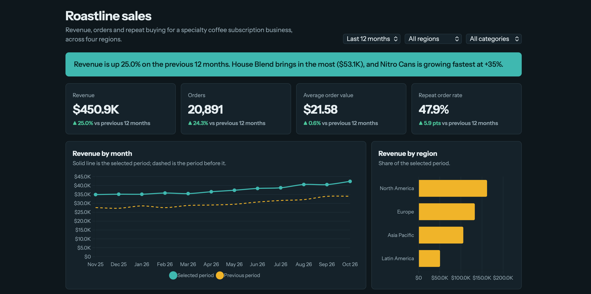

# Roastline: Sales Analytics Dashboard

An interactive dashboard that tracks revenue, orders and repeat buying for a fictional specialty coffee subscription business across four regions.

**[Live demo](https://Wazna02.github.io/roastline-dashboard/)**

## What it does

- **Filters everything at once:** choose a time range (3, 6 or 12 months), a region and a product category, and every number and chart updates together.
- **Period-over-period KPIs:** revenue, orders, average order value and repeat order rate, each compared with the previous period.
- **Trend analysis:** a monthly revenue line charted against the prior period, plus revenue breakdowns by region and category.
- **Sortable product table:** revenue, orders and percentage change for each product.
- **Auto-generated insight:** a summary sentence at the top that rewrites itself from the current filters, naming the top product and the fastest-growing one.
- **Responsive and theme-aware:** works on phones and follows your light or dark mode setting.

## Tech

- Vanilla JavaScript, HTML and CSS (no framework, no build step)
- [Chart.js](https://www.chartjs.org/) for charts
- A seeded random generator that produces 24 months of repeatable sample data

## How it works

Sample data is generated in the browser as one record per month, region and product, with seasonality, product-level growth trends and noise. Each filter change slices that dataset into a current period and an equal-length previous period, then recomputes the KPIs, charts and table from those two slices.

## Run it locally

Download `index.html` and open it in any browser. No installation needed.

## Possible next steps

- Load a real dataset from an uploaded CSV
- Add a cohort retention chart
- Export the filtered view to CSV

## Note on the data

All numbers are synthetic and generated for demonstration purposes.
